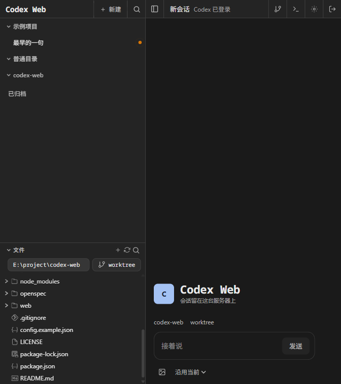
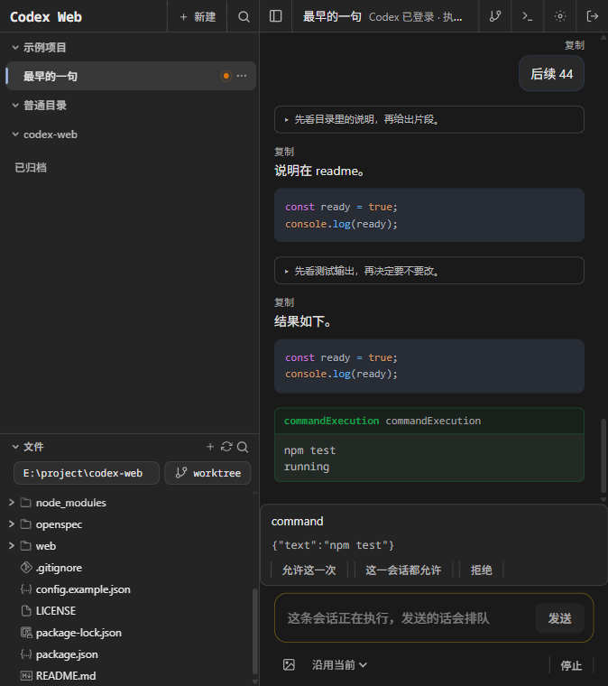
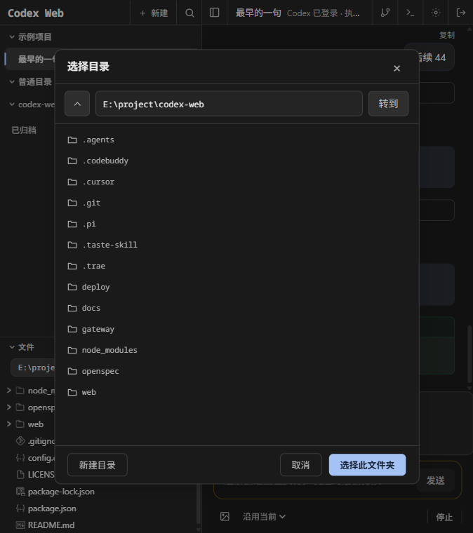

# Codex Web

把自己的服务器变成一部可以多人打开的 Codex。手机和电脑都用浏览器进同一套会话，关掉页面不会把正在跑的任务停掉。

执行引擎只用官方 `codex`。浏览器不持有代理进程，也不直接和 app-server 说话。网关拉起并守住唯一一个 `codex app-server`（标准输入输出）。不要再启动第二个 app-server 去占用同一份 `CODEX_HOME`。

网页登录密码和 Codex 账号不是同一个东西。密码只决定谁能打开这个页面。网关以 root 运行，所以页面密码等同于这台机器的 root：审批通过后的命令也是 root 执行的。

## 界面

新开会话时，工作目录已经选好，对话还是空的。关掉这个页面，服务器上的会话还在。



一条会话正在执行。命令要不要跑，就在这一轮里决定。



点侧栏里的路径可以换目录。选中之后文件树直接显示那个目录，不用先开会话。



## 功能

几台电脑和手机打开同一个地址，看的是服务器上的同一批会话。关掉浏览器或关掉电脑，网关和 `codex app-server` 继续跑，回来还能接着看。

浏览器只负责显示。它不启动 Codex，也不保存对话正文。正文在服务器的 `CODEX_HOME`。平台数据库只记项目、会话所在目录、任务状态、审批和排队。

### 会话

一个目录下可以有多条会话，不同会话可以同时执行。同一条会话一次只跑一轮。这一轮还没结束时再发一句，会排在后面，等这一轮完成或失败才开始。按停止，或者网关重启，都不会自动把队列跑起来。进程中途停掉时，还在执行或等待审批的回合标成中断，不会重放。

助手的字是逐段出现的。思考过程收在可以展开的块里。顶栏显示 Codex 是否已登录，以及这一轮已经跑了多久。

会话可以改名、置顶、归档、分叉和删除。正在执行或等待审批时不能删除。侧栏按标题搜索。分叉用 Codex 的 `thread/fork`，分出去的是整段会话。

新开会话时，Git 仓库可以选择直接用当前目录，或为这次会话检出一个 worktree。worktree 在仓库旁边的 `<仓库名>-worktrees/<分支名>`，不在数据目录里。普通目录没有 worktree。

### 审批

命令和文件变更需要确认时，按钮出现在这一轮里：允许这一次、这一会话都允许、拒绝。命令和文件变更的授权是分开记的。选了「这一会话都允许」之后，同一类后续请求会自动同意。认不出来的类型仍然会问。

页面上没有改过沙箱和审批策略时，开新会话不会替你指定。用的是这台机器 `CODEX_HOME` 里已有的 Codex 配置。

### 目录、文件和终端

点侧栏里的路径，可以浏览进程读得到的目录，并在能写的地方新建子目录。选中目录后，文件树马上显示那个目录。已经打开的会话显示那条会话自己的工作目录；换到另一个项目时，文件树跟着新项目走。

网页里的终端开在当前会话的目录。服务器上要有编译好的 `node-pty`，否则终端会显示启动失败，页面其余部分不受影响。

### Git

暂存、还原、提交、推送由网关直接调用 `git`，不经过模型。创建 pull request 调用本机的 `gh`。失败时页面给出原因，不会编一个链接。输出里的令牌会被抹掉。

### 外观和登录

设置里可以换主题。登录框只有密码，没有用户名。这个密码和 Codex 账号无关：页面能打开，只说明你有这台服务器的网页口令；顶栏要显示「Codex 已登录」，还得用同一份 `CODEX_HOME` 做过 `codex login`。

能登录页面，就等于能在这台机器上以 root 执行获批的命令。

下面这些当前做不到，因为官方 app-server 没有交给网页：用量和费用、压缩上下文、思考强度、浏览器推送、技能和斜杠命令。

## 给别人或 AI：先跑这一条

在已经装好 Node.js 22.19+ 的 Linux 上，克隆仓库后执行：

```sh
sudo bash deploy/install.sh
```

脚本会安装依赖、构建页面、写入 `/etc/codex-web/config.json`、安装 `codex-web` 服务并启动。第一次运行会在终端打印网页登录密码，只打印一次。已有配置文件不会被覆盖，密码也不会改。

需要从别的机器访问时：

```sh
sudo bash deploy/install.sh --bind 0.0.0.0 --port 8081
```

Codex 必须走本机代理时：

```sh
sudo bash deploy/install.sh --proxy http://127.0.0.1:7890
```

| 选项 | 作用 | 默认 |
| --- | --- | --- |
| `--bind` | 监听地址 | `127.0.0.1`，只有本机能打开 |
| `--port` | 监听端口 | `8787` |
| `--proxy` | 传给 Codex 进程的 `https_proxy` | 不设置，直连 |
| `--password` | 只在第一次生成配置时使用 | 随机生成并打印 |
| `--data-dir` | 平台数据库和 `CODEX_HOME` 的父目录 | `/var/lib/codex-web` |

脚本不会做这些事：

- 不执行 `codex login`。登录必须由人完成。
- 不覆盖已经存在的 `/etc/codex-web/config.json`。
- 发现有正在执行或等待审批的回合时，不重启网关。
- 不启用 `deploy/codex-app-server.service`。如果机器上已经启用了这个单元，脚本会停掉它。

装好后用下面两条确认。第二条应返回 `401`。

```sh
systemctl is-active codex-web
curl -s -o /dev/null -w '%{http_code}\n' http://127.0.0.1:8787/api/account
```

端口如果改过，把 `8787` 换成实际端口。

## 安装之前

- Linux，并且有 systemd。脚本要 root。
- Node.js 22.19 或更新。`node` 必须在 root 的 `PATH` 里。脚本会把当时的绝对路径写进服务，避免以后换成另一个 node。
- 官方 `codex`。找不到时，脚本安装 `@openai/codex@0.166.0`。机器上已经有 `codex` 时不会重装；脚本把 `codex --version` 的最后一个字段写进 `allowedCodexVersions`。版本不在名单里，网关拒绝启动。
- 能编译原生模块的工具。脚本在有 `apt-get` 或 `dnf` 时安装 `python3`、`make`、`g++`、`git`、`bubblewrap`。网页里的终端依赖 `node-pty`，编译失败时页面仍能打开，终端会显示启动失败。

Ubuntu 上如果还没有 Node.js 22：

```sh
curl -fsSL https://deb.nodesource.com/setup_22.x | bash -
apt-get install -y nodejs
node -v
```

## 登录 Codex

网页能打开之后，用网关同一份 `CODEX_HOME` 登录。不要 `codex logout`。

```sh
CODEX_HOME=/var/lib/codex-web/codex-home codex login
systemctl restart codex-web
```

`--data-dir` 改过的话，把路径换成那个目录下的 `codex-home`。重启会把当时还在跑的回合标成中断，不会自动重放。登录完成后刷新页面，顶栏应显示「Codex 已登录」。

## 打开页面

浏览器打开 `http://<监听地址>:<端口>/`，输入安装时打印的密码。登录框没有用户名。

`bind` 仍是 `127.0.0.1` 时，别的机器访问不了。要对外提供，用 `--bind 0.0.0.0`，再由防火墙或端口转发放行。不要把 Codex 的 app-server 暴露出去；它没有单独监听端口。

## 再次部署

代码更新后，在仓库目录再执行一次：

```sh
sudo bash deploy/install.sh
```

再次执行时如果没写 `--proxy` 或 `--data-dir`，会保留服务里已经写好的代理和 `CODEX_HOME`。

它会重新构建页面。没有正在执行的回合时重启网关；有的话会停下来，并告诉你稍后执行 `systemctl restart codex-web`。只换了页面静态文件时，其实不重启也能在下次请求读到新文件，但这条命令仍以服务里的程序目录为准。

升级了 `codex` 之后也要再跑一次，好把新版本号补进允许列表。

## 配置字段

文件是 `/etc/codex-web/config.json`，权限 `600`。字段缺一不可。

| 字段 | 含义 |
| --- | --- |
| `bindHost` / `bindPort` | 网页和 API 的监听地址 |
| `password` | 网页登录密码。网关每次启动都会按这个值更新口令哈希 |
| `username` | 写进平台数据库的用户名。登录框不使用它 |
| `dataDir` | 平台 SQLite 所在目录，文件是 `<dataDir>/app.db` |
| `allowedCodexVersions` | 允许的 `codex --version` 版本号 |
| `projectRoots` | 必须是非空字符串数组，配置才能通过解析。它不是目录白名单。页面可以打开进程读得到的任何目录 |
| `appServerSocket` | 必须填写。当前网关不用这个 socket，而是自己拉起 `codex app-server` |
| `httpsProxy` | 必须是非空字符串。网关不读它。真正影响 Codex 出站的是服务单元里的 `https_proxy` |

没有代理时，配置里的 `httpsProxy` 可以留着 `http://127.0.0.1:9`。不要因为这个字段去启动一个代理。

改密码：编辑 `password` 后执行 `systemctl restart codex-web`。不要把这个文件提交进仓库。

## 数据放在哪

| 内容 | 位置 |
| --- | --- |
| 网页登录、项目、任务、审批、队列、会话所在目录 | `<dataDir>/app.db` |
| 会话正文 | `$CODEX_HOME`，默认 `/var/lib/codex-web/codex-home` |
| 单独检出 | 仓库上一级的 `<仓库名>-worktrees/<分支名>` |

平台数据库不保存对话正文。Git 仓库里的新会话可以选择单独 worktree，也可以直接使用项目目录。普通目录没有 worktree。

## 不要这样做

- 不要 `systemctl enable --now codex-app-server`。仓库里的 `deploy/codex-app-server.service` 是旧草案。
- 不要同时手工再跑一个 `codex app-server`。
- 服务的启动参数只有 `--experimental-strip-types`。不要加上 `--experimental-transform-types`，那个参数会让网关入口的顶层 await 起不来。
- 进程重启会把进行中的回合标成中断，不会自动重放。
- 不要把网页密码、Codex 令牌或代理订阅写进仓库和日志。

查看网关日志：

```sh
journalctl -u codex-web -n 80 --no-pager
```

## 本地检查

开发和测试需要 Node.js 22。Windows 上可以跑测试和构建，一键安装脚本只用于 Linux 服务。

```sh
npm install
npm test
npm run build
```

`npm test` 只跑网关测试。`npm run build` 生成 `web/dist`，网关和页面共用一个端口。本地临时看页面时，另开一个终端执行 `npm run dev -w web`，开发服务器在 `http://127.0.0.1:5173`，并把 `/api` 转到 `127.0.0.1:8787`。

## 协议

本仓库使用 [MIT](LICENSE)。`web/public/icons/catppuccin/` 里的图标也是 MIT，许可文本在该目录的 `LICENSE`。
